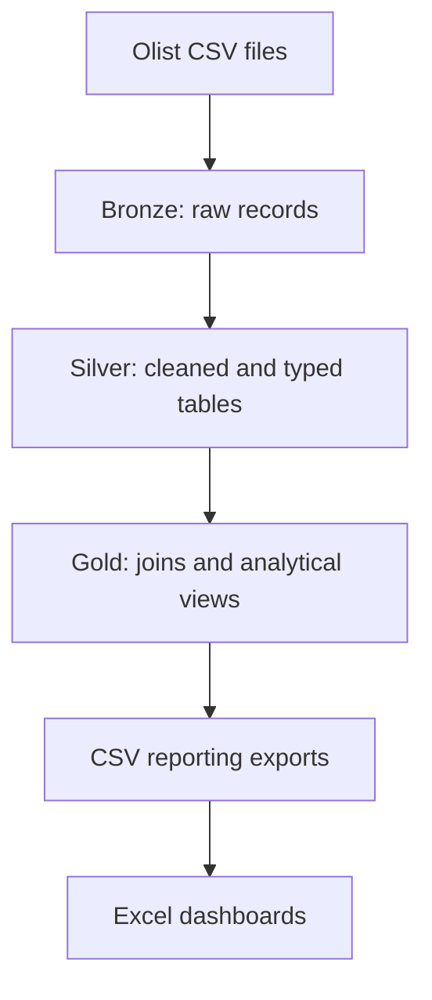
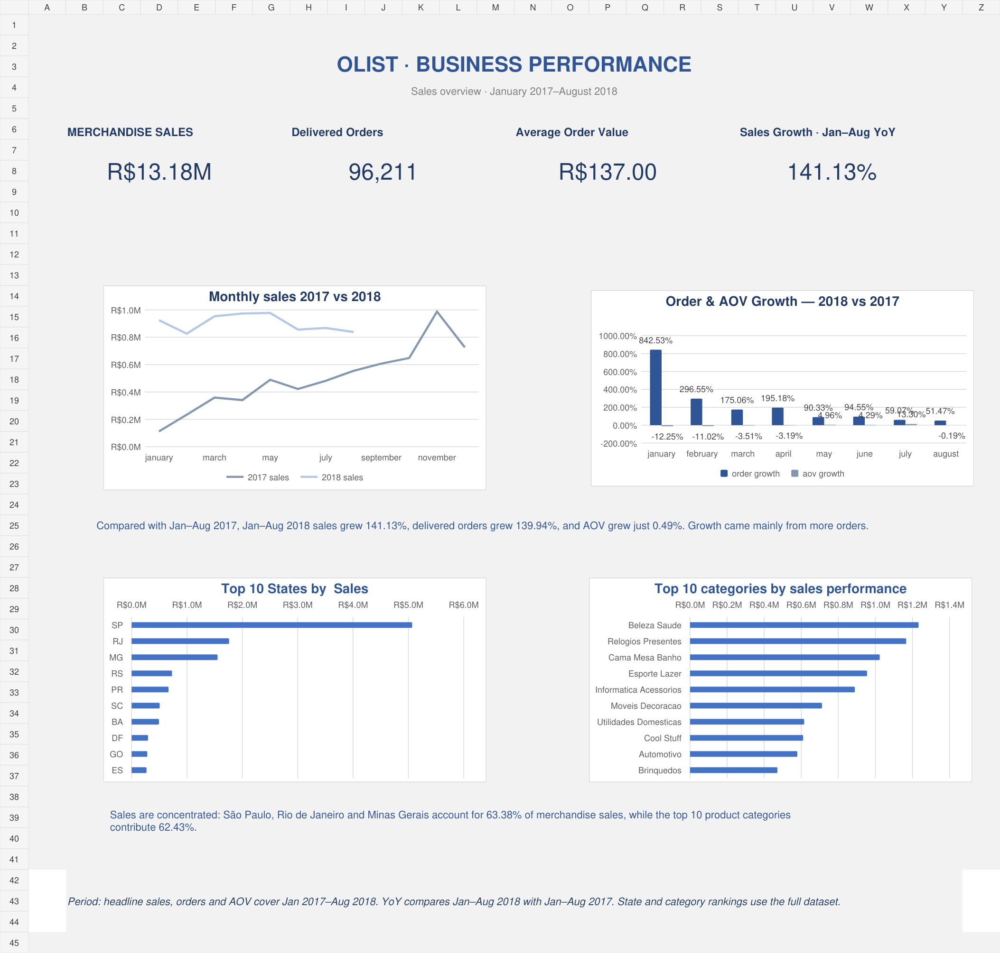
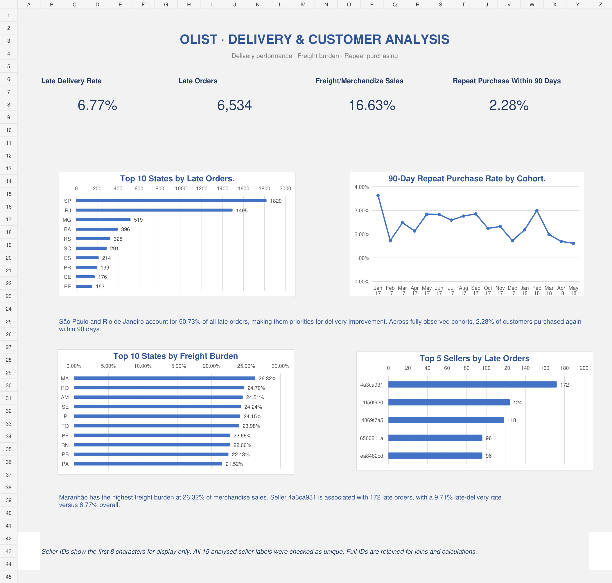

# Olist E-commerce Analysis

A PostgreSQL reporting project with two Excel dashboards examining sales growth, delivery performance, freight burden and repeat purchasing in Olist's historical Brazilian e-commerce dataset.

**Author:** Aderinwale John O. · [GitHub](https://github.com/Jaydafuhrer)

**Primary tools:** PostgreSQL, SQL and Microsoft Excel. Python supports verification of the exported reporting figures; Git tracks the project.

## Business questions

- Did sales growth come from more orders or higher average order value?
- Which states and product categories account for the largest share of sales?
- Where does late-delivery volume warrant investigation?
- How often did customers purchase again within 90 days?
- Which states have high freight costs relative to merchandise value?
- Which sellers are associated with the greatest late-order volume?

## Architecture



Items and payments are aggregated separately before joining to orders. This prevents item/payment joins from multiplying monetary totals. Customer repeat analysis uses `customer_unique_id`; seller analysis retains full seller IDs.

## Dashboards

Open [the Excel workbook](dashboard/olist_dashboard.xlsx) in Microsoft Excel. Supporting worksheets are retained because the charts and formulas depend on them.

### Executive overview



| Metric | Result | Scope |
|---|---:|---|
| Merchandise sales | R$13,181,027.13 | Jan 2017–Aug 2018, delivered orders, excludes freight |
| Delivered orders | 96,211 | Jan 2017–Aug 2018 |
| Average order value | R$137.00 | Merchandise sales / delivered orders |
| Sales growth | 141.13% | Jan–Aug 2018 vs Jan–Aug 2017 |

The monthly comparison leaves Sep–Dec 2018 blank. State and category rankings use the full dataset, as noted on the dashboard.

### Delivery and customer analysis



| Metric | Result | Scope |
|---|---:|---|
| Late-delivery rate | 6.77% | 6,534 / 96,470 delivery-eligible orders, full dataset |
| Late orders | 6,534 | Full dataset |
| Freight / merchandise sales | 16.63% | Jan 2017–Aug 2018 |
| Repeat purchase within 90 days | 2.28% | 1,711 / 75,123 customers, Jan 2017–May 2018 cohorts |

Freight rankings require at least 100 delivered orders. Seller screening requires at least 100 delivery-eligible orders. The seller chart shows the top five by late-order count from a 15-seller export.

## Findings and possible actions

| Finding | Implication |
|---|---|
| Matched Jan–Aug sales grew 141.13%, orders grew 139.94%, and AOV grew 0.49%. | Growth mainly reflected order volume; investigate fulfilment capacity. |
| SP, RJ and MG contributed 63.38% of full-dataset merchandise sales. The top ten categories contributed 62.43%. | Service and availability in these segments affect a large share of sales. |
| SP and RJ accounted for 50.73% of late orders. | Investigate their late-order volume alongside local delivery rates. |
| Across fully observed cohorts, 2.28% purchased again within 90 days. | Explore customer experience and repeat-purchase opportunities. |
| Maranhão's freight burden was 26.32%, highest among states with at least 100 delivered orders. | Examine distance, product mix and carrier costs before changing shipping policy. |
| Seller `4a3ca931` was associated with 172 late orders and a 9.71% late rate, against 6.77% overall. | Review the seller's order/carrier mix; association does not establish responsibility. |

**Seller labels:** eight-character prefixes are for display only. All 15 analysed labels were checked as unique. Full IDs remain in the source export and are used for joins and calculations. This check does not establish prefix uniqueness across every seller in the dataset.

Read [metric definitions and limitations](docs/methodology.md) and [refresh instructions](docs/refresh.md).

## Repository contents

| Folder/file | Purpose |
|---|---|
| `sql/00_setup.sql` | Bronze and silver table layouts recovered from metadata |
| `sql/01_import.psql` | Raw CSV loading with psql |
| `sql/02_load_silver.sql` | Reconstructed cleaning and typing logic |
| `sql/03_reporting_views.sql` | Recovered core reporting views, migrated to gold |
| `sql/07_dashboard_views.sql` | Five reconstructed final-dashboard view definitions |
| `sql/04_analysis_queries.sql` | Read-only reporting queries |
| `sql/05_validation.sql` | Dashboard metric reconciliation against snapshot controls |
| `sql/06_export.psql` | Export queries for refreshing Excel inputs |
| `dashboard/` | Final workbook and previews of both dashboard layouts |
| `data/exports/` | Aggregated reference CSVs and derived insights |
| `docs/` | Methodology, refresh instructions, source metadata and verification record |
| `scripts/derive_insights.py` | Recompute insights from the included exports |

## Supporting Python verification

The SQL views produce the reports, and Excel presents the dashboards. `scripts/derive_insights.py` reads the included CSV snapshots to independently recompute growth, weighted AOV, repeat-purchase rates, concentration and delivery metrics. It checks eight-character seller-prefix uniqueness among the 15 analysed sellers and writes `data/exports/derived_insights.csv`. It uses Python’s standard library and does not load PostgreSQL or generate the workbook.

## Run from source

Use a separate empty PostgreSQL database. Download the [Olist dataset](https://www.kaggle.com/datasets/olistbr/brazilian-ecommerce) into `data/raw/`. Raw files are excluded from this repository.

```bash
mkdir -p data/raw data/refreshed
psql -d olist_reproduction -v ON_ERROR_STOP=1 -f sql/00_setup.sql
psql -d olist_reproduction -v ON_ERROR_STOP=1 -f sql/01_import.psql
psql -d olist_reproduction -v ON_ERROR_STOP=1 -f sql/02_load_silver.sql
psql -d olist_reproduction -v ON_ERROR_STOP=1 -f sql/03_reporting_views.sql
psql -d olist_reproduction -v ON_ERROR_STOP=1 -f sql/07_dashboard_views.sql
psql -d olist_reproduction -v ON_ERROR_STOP=1 -f sql/05_validation.sql
psql -d olist_reproduction -v ON_ERROR_STOP=1 -f sql/06_export.psql
python3 scripts/derive_insights.py
```

`.sql` files can run in pgAdmin Query Tool. `.psql` files contain client commands and require psql. See [refresh instructions](docs/refresh.md).

## Verification status

The final workbook's cached headline values, chart references, exported reporting tables and derived findings were checked locally. Dashboard previews were rendered from the final workbook. The delivered workbook preserves the existing charts, formula caches, source tables and layout.

Core SQL definitions and bronze/silver column layouts were recovered from database metadata. The original loading statements and exact CREATE statements for the five added dashboard views were not supplied; those scripts are reconstructed and labelled accordingly. On 11 October 2026, the author reported completing a fresh-database reproduction in `olist_confirmation` and confirmed that the final dashboard views and validation checks passed. A supplied PostgreSQL screenshot independently shows PASS for 99,441 orders, 96,478 delivered orders, R$13,221,498.11 full-history merchandise sales and R$137.04 full-history AOV. The remaining dashboard checks were confirmed by the author; their result grid was not retained in this package. SQL was executed on the author’s Mac, not in the packaging environment. This is a validated local reproduction, not a production deployment.

## Source

[Olist Brazilian E-Commerce Public Dataset](https://www.kaggle.com/datasets/olistbr/brazilian-ecommerce). Source dataset terms apply. Raw CSVs are not redistributed. Results describe historical observations, not current Olist performance.
